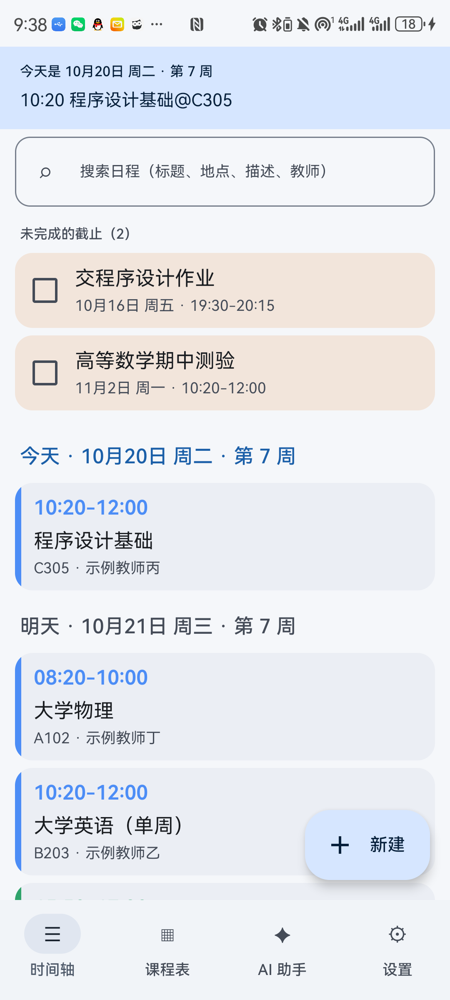
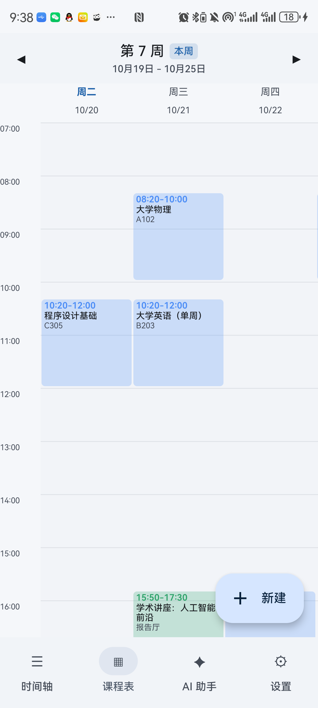
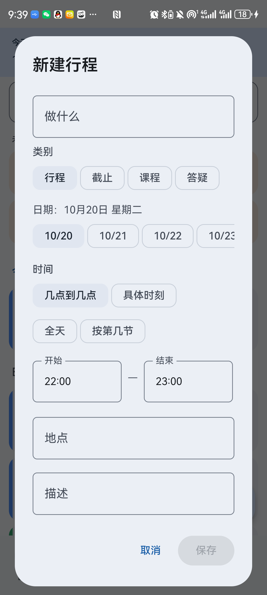
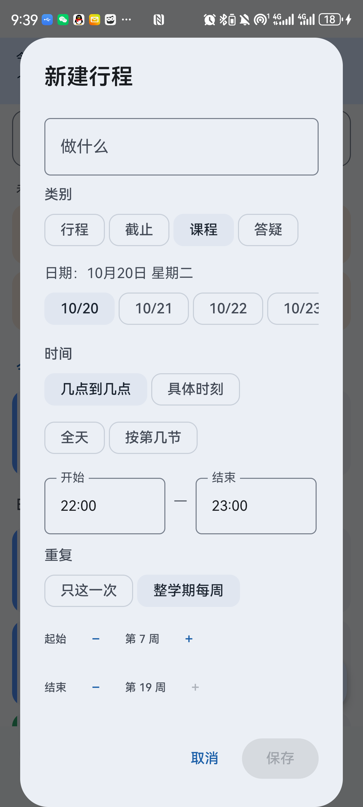
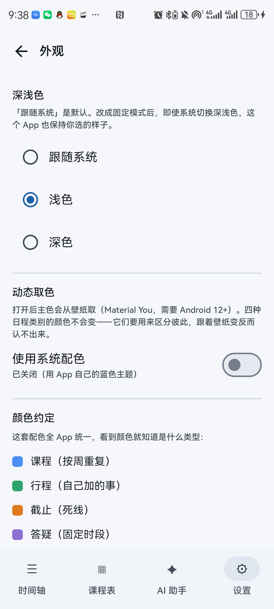

# 课隙 · Kkexi

> 把课表、作业截止和临时安排放进同一条真实时间轴，到点提醒。
> 一个离线优先的 Android 日程 App，AI 只是可选的助手。


## 这是什么

手机日历不认「第几周」，便签不会提醒，课程表 App 又只能看课。
课隙把这三件事合成一件：**一张课表、一条时间轴、一个本地提醒**。

- 不登录、不联网也能用
- 课表按真实时间排，不是固定格子
- 作业、报名截止会置顶，勾掉才消失
- 可选接入 DeepSeek 或任意 OpenAI 兼容接口：粘贴一段话、发一张课表图，
  先生成候选，**逐条确认后才入库**

## 功能

| 功能 | 说明 |
|---|---|
| 时间轴 | 今天、明天、本周……按真实时刻排序；正在进行的日程会高亮 |
| 课程表 | 按真实时间画网格，重叠课程并排分栏，带当前时间线 |
| 四种时间 | 一段区间 / 一个具体时刻 / 全天 / 按课节（课节只是录入方式，显示仍是真实时刻） |
| 整学期课程 | 一次设好起止周与单双周，不用每周补录 |
| 截止 | 未完成截止置顶，可勾选完成 |
| 提醒 | 本地通知；可设提前量、每日汇总 |
| AI 解析（可选） | 文字或课表截图 → 候选卡片 → 逐条修改 → 确认入库 |
| 一手资料 | 点开日程可回看当时喂给 AI 的原文/原图；原图支持全屏缩放 |
| 搜索 | 按标题、地点、描述、教师搜整个学期 |
| 备份 | 导出/导入 JSON，**一手资料原图也会一起打包**；连作息表、类别、外观设置一起带走 |
| 外观 | 跟随系统 / 浅色 / 深色；Android 12+ 可选动态取色 |

## 界面

> 截图使用内置的虚构示例数据（示例教师甲/乙、A101/B203 等），不含真实课表。

<p align="center">
  
  
</p>

<p align="center">
  
  
</p>

<p align="center">
  
</p>

## 隐私

这是这个项目最在意的一件事：

- **无账号、无服务器、无遥测**
- API Key 只存在本机，只发往你自己填的接口地址
- 默认空库启动；内置示例数据全部是虚构的
- 不联网也能完成看课表、增删改、提醒
- 仓库不包含任何真实课表、真实姓名、真实教室或设备标识

## 构建

需要：

- JDK 21
- Android SDK（compileSdk 37）
- Gradle 9.6.0（或直接用 Android Studio 打开）

```bash
gradle assembleDebug
# 产物：app/build/outputs/apk/debug/app-debug.apk
```

仓库刻意不包含 SDK / JDK / Gradle 和签名文件；`keystore.properties` 不存在时
debug 仍可正常构建。

## 项目结构

```
app/src/main/java/com/ww/kkexi/   应用代码（Kotlin + Compose + 手写 SQLite）
app/src/test/java/com/ww/kkexi/   190 条 JVM 单元测试
gradle/libs.versions.toml         依赖版本
```

> 开发脚本、示例截图和真实使用数据都不进仓库，避免带出本机信息。

## 技术栈

- Kotlin + Jetpack Compose（Material 3）
- 手写 SQLite，不用 Room / KSP
- 单 Activity + ViewModel + Repository
- 单元测试直接跑 JUnit，不依赖模拟器

## 已知局限

- 在 Android 12 与 Android 15 真机上验证过，其他版本未覆盖
- AI 读课表截图可能把某一列的课归到相邻星期，必须逐条核对
- 提醒依赖系统通知/闹钟权限；不同 ROM 的后台策略可能影响准时性
- 只有 Android，没有 iOS / Web

## 状态

早期版本（0.1.0），接口和数据格式还可能调整。

## License

MIT
